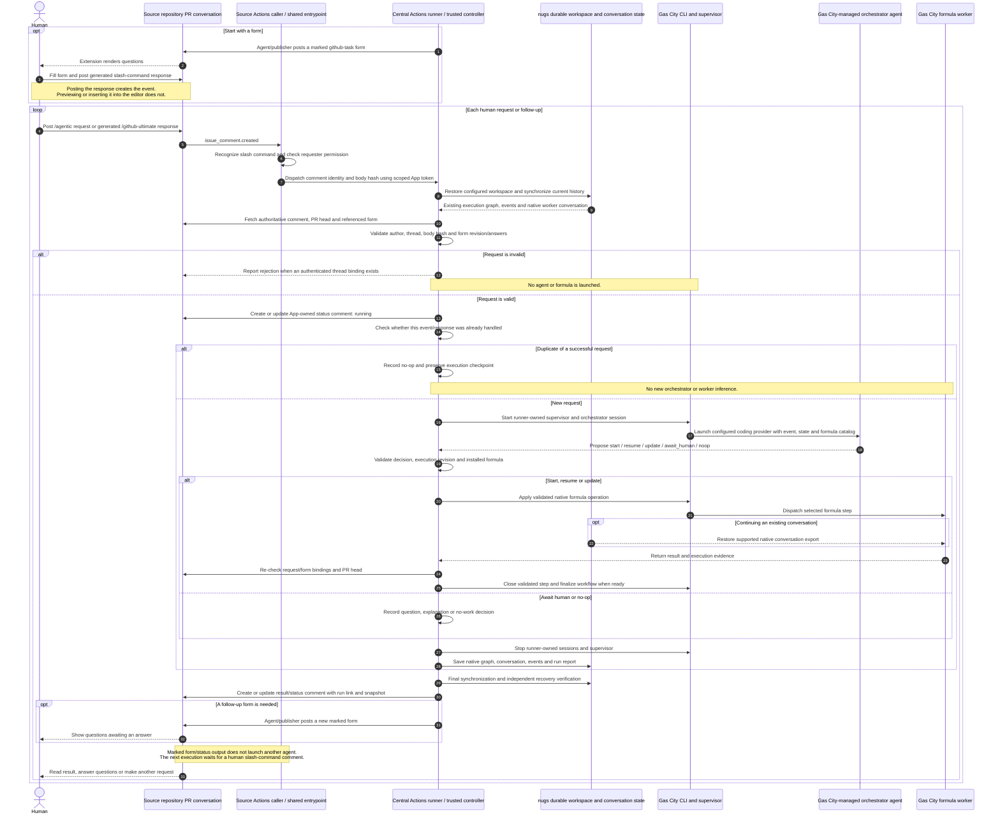

# PR comment → agent decision → workflow → PR comment → repeat

The PR conversation is the human-facing entry point. Each accepted human request
starts a bounded GitHub Actions run. A Gas City-managed orchestrator chooses how
to advance the work; durable state connects that run to the next human reply.

## End-to-end sequence

The initial form submission is the first iteration's request; it is not a second
comment that must be posted again at the top of the loop. A plain `/agentic ...`
comment can start the same flow without a form.

## What the agent decides

| Decision | Effect |
| --- | --- |
| `start` | Instantiate an installed formula for a new request. A new graph can follow a completed workflow while retaining conversation history. |
| `resume` | Continue an incomplete execution and restore its native worker conversation. |
| `update` | Incorporate the latest instructions or form answers into pending work. |
| `await_human` | Persist the need for clarification and end the current run. |
| `noop` | Record that the request needs no additional work. Successful duplicates are detected before launching the agent. |

The installed catalog currently contains `investigate` and `plan-change`.
Their workers perform read-only investigation and planning. A form's approval
intent does not add source-editing capabilities to those workers.

## Comments and repetition

- **Human request:** `/agentic <request>`, or the extension-generated
  `/github-ultimate discuss` / `/github-ultimate approve` plus its structured
  response. Ordinary conversation comments do not launch agents.
- **Status/result:** the current implementation creates one App-owned status
  comment per PR and updates it on subsequent runs. It contains readable results,
  links and a `github-workflow` snapshot. Per-run reports remain in nugs.
- **Form:** a publisher can create a new `github-task` form comment. The current
  form CLI supports this, including forms published manually by an agent. The
  workflow does **not yet automatically generate a fresh form for every human
  gate**; that branch in the diagram is the intended publisher integration.
- **Loop prevention:** form and status output contains
  `<!-- github-ultimate:form:` and is skipped by the entrypoint. An agent's output
  is not itself a new execution request.

In short, the repeating interaction is:

> Human posts request → orchestrator chooses an operation/formula → Gas City runs
> work → results and state are saved → PR receives an update or new form → human
> posts a follow-up → a fresh runner continues the durable conversation.

## Ownership of the steps

The diagram describes the current implementation: Python adapters perform the
trusted GitHub integration, decision application, persistence and reporting;
Gas City launches the orchestrator and workers and owns the native formula graph.
The orchestrator makes the high-level workflow decision. Making it use Gas City
more directly would thin the controller layer without changing this human-facing
sequence.

Execution and publication failures are tracked separately. Ordinary worker failure
still runs final persistence; invalid requests never reach inference. A runner
lost abruptly may leave the last saved checkpoint/status. Actions concurrency
serializes each repository/PR, but its pending slot is not a durable request queue.

For configuration, validation and source links, see
[PR comment workflow](pr-comment-workflow.md) and
[Gas City execution core](gascity-event-orchestrator.md).
