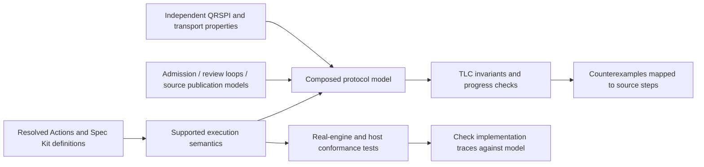

# Resumable Actions: small mechanisms and a protocol composition

Owner: `task-8a7.2`. Offline bounded-model-checking spike. It complements the
Questions/YAML verification under `task-8a7.1`; it does not modify that worktree,
the production runner, its accepted policies, or any human decision.

## Goal

Use TLA+ both for small correctness-critical mechanisms and the protocol spanning
multiple GitHub Actions invocations. A system proof needs the latter: individually
correct workers do not establish correct dispatch/checkpoint/approval composition.

## Reproduce

Node 22.19+, Java, and TLC 1.7.4 are required. The harness verifies the jar's SHA-256
`936a262061c914694dfd669a543be24573c45d5aa0ff20a8b96b23d01e050e88`.
Use an installed Java runtime and digest-verified jar, including those provisioned
by the existing Questions spike. No Python or package installation is needed by
this harness; no runtime dependency is added to Actions.

```sh
JAVA_BIN=/absolute/path/to/java TLC_JAR=/absolute/path/to/tla2tools-1.7.4.jar \
  node --experimental-strip-types check.ts
```

There are nine scenarios: two valid models and seven expected counterexamples.
Each TLC process has a 60-second/512-MiB bound. Failure, timeout, unexpected exit
or missing expected invariant failure fails the harness. Generated configs and
TLC state are temporary local files removed on completion; no evidence uploads,
credentials or model calls occur. Checkpoints/transcripts from live runs are not
inputs to this spike.

## What is checked now

`Admission.tla` splits the actual pre-read, ordinary PUT and exact readback into
separately interleavable actions. Two callers with serialization satisfy
`SingleAdmission`. Without serialization TLC produces a counterexample even with
strongly consistent storage:

1. Both callers read absent.
2. Caller A writes and reads back its own value, admitting A.
3. Caller B writes and reads back its own value, admitting B.

This is the already accepted non-atomic storage policy, not a newly imposed
requirement to change it. Exactly-once admission cannot be claimed unconditionally.
The serialized model relies on all relevant writers sharing the exclusion scope
and on reads observing committed writes. It does not prove GitHub enforces that
scope, cover other workflow files/repositories, or model stale storage reads.

`Resumption.tla` composes a reference protocol across admission, an external
candidate effect, its acknowledgement, checkpoint publication, an external human
response, revision, downstream dispatch, crash and bounded reconciliation.
`Properties.tla` defines the invariants separately from transition guards:

| Property | Meaning in this finite model |
| --- | --- |
| `TypeOK` | Every reachable state stays within the declared state domains. |
| `NoEffectReplay` | A crash/recovery does not repeat the candidate effect for the same revision. |
| `CheckpointHasCandidate` | A visible checkpoint refers to a candidate effect that actually exists. |
| `ExactAuthorizedApproval` | Approval is authenticated, same-scope and bound to the current candidate/checkpoint; revision invalidates it. |
| `ResponseConsumedOnce` | Duplicate feedback does not dispatch the same revision twice. |
| `ObservableOutcome` | Internal execution eventually reaches waiting, done or an explicit blocked result. Human answers are not assumed to arrive. |

Six protocol mutations are caught: blind retry of an uncertain attempt, omitted
authentication, omitted scope checking, stale revision acceptance, retained
approval after revision, and duplicate receipt consumption. These mutations
demonstrate sensitivity of the properties, not bugs found in production.

## Assumptions and limits

The protocol model has one logical process, two candidate revisions, one possible
crash, a single abstract candidate effect per revision, and one human response
consumption per revision. Invalid auth/scope/revision inputs are explored. Scope is
an abstract boolean, **not** concurrent two-process noninterference verification.
Scheduling weak fairness applies only to internal actions; external human events
need no fairness. The model permits an indefinite legitimate human wait.

An acknowledged effect is assumed durably inspectable and reusable. Missing
authoritative evidence yields `blocked`, not permission to retry. `Reconcile`
abstracts a verified recovery capability; it is **not** a claim that the current
runner can automatically recover every crash location. Current initialization and
discussion-publication recoveries have narrower predicates. The candidate effect
is not a model of arbitrary Git/S3/network side effects, and response consumption
is an abstract atomic action whose implementation still needs refinement checks.

This is a hand-authored reference model, not generated from Actions YAML or
TypeScript. TLC explores the bounded models, not GitHub's implementation. No
complete QRSPI, entire deployment, unbounded correctness or implementation
refinement proof is claimed. Safety can be preserved by blocking; automatic
eventual recovery after arbitrary failures is a separate, stronger property.

## Mapping to the inspected implementation

Source baseline: engine `36a671dff7599328384ca5d941fa8210e8fc18b2`.

| Model boundary | Source contract to refine/test |
| --- | --- |
| Serialized admission | `.github/workflows/qrspi-process.yml` per-workspace/process concurrency group; `.github/qrspi-hosted/storage.ts` lines 69–110 ordinary PUT/preflight/readback. |
| Intent before work, uncertain blocking | `workspace-main.ts` lines 75–111 active invocation/admission and lines 113 onward execution. |
| Exact external authority | `identity.ts`, `core.ts` `checkScope`, `workspace-main.ts` lines 93–105 and 171–181 exact-byte approval. |
| Publication then settlement | `workspace-main.ts` lines 186–220 retained discussion, artifact/request publication, checkpoint write, admission and active settlement. These are multiple real effects, abstracted here. |
| Narrow positive reconciliation | `workspace-recovery.ts`, `workspace-publication-recovery.ts`; not a generic stale-lease retry. |
| Mini-workflow execution | The separate Questions/YAML proof links supported YAML control flow to actual Spec Kit execution. This model does not yet import it. |

## Design for whole-system verification



The composed model must preserve communication windows, rather than collapsing
publish-candidate, publish-request, checkpoint, receipt and settlement into a
fictitious transaction. Components require explicit rely/guarantee contracts;
their individual green checks cannot simply be added together into a system proof.

### Next bounded verification increments

1. Split publication and receipt acceptance into real side effects, acknowledgements
   and lost-ack windows; model exact recovery predicates and unknown-vs-missing
   reads. Include setup dispatch acknowledgement loss and selected engine pins.
2. Compose two processes and duplicate/out-of-order callbacks, old workers and
   current-head integration. Check state isolation and prevent stale-worker writes;
   retain the actual best-effort storage assumption rather than inventing CAS.
3. Import the supported mini-workflow transition system: fan-out/fan-in, shared
   review budget, explicit exhaustion and RED-before-implementation. Tie approvals
   to input/source vectors and model downstream invalidation across dependencies.
4. Check deterministic host/Spec Kit traces for conformance, then inject cancellation
   at every durable-effect boundary in real Actions. Use private S3 evidence and
   compare observed histories with the same model event vocabulary.
5. Maintain a requirement-to-property-to-test matrix. Unknown YAML/custom-step
   semantics fail closed; changes to the runner or workflow definitions invalidate
   earlier conformance evidence until rechecked.

These are verification increments, not another runtime workflow engine. Model
state is specification-only and never becomes a competing approval/status store.

## What TLA+ cannot establish by itself

Model judgment quality, meaningful tests, operating-system/tool isolation, actual
provider/storage/GitHub guarantees, and correctness of arbitrary scripts require
other evidence. Authentication is abstracted as verified identity, not a proof of
cryptography. Check safety unconditionally within the declared failure model;
claim progress only under explicit delivery, availability and fairness assumptions.
